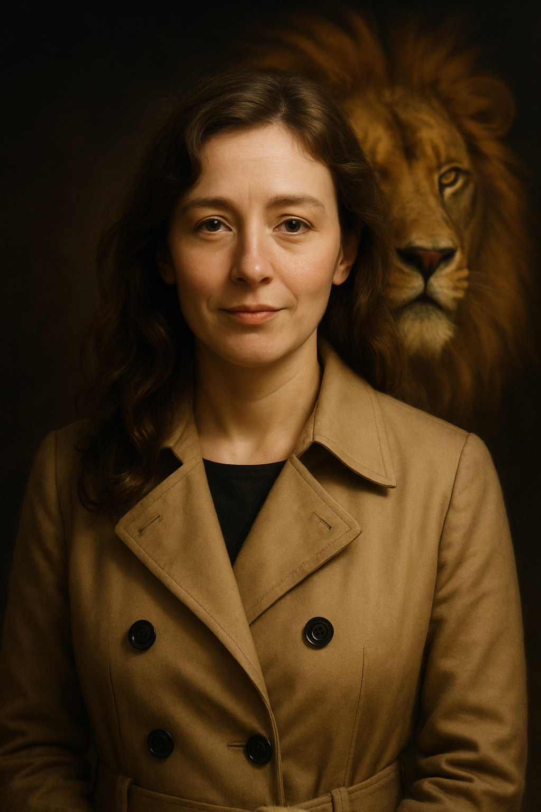

---
hide:
- navigation
- toc
---

# Preface

Dear reader,

!!! tip "August 2026 update from Jerusalem"
    - There was *a lot* more truth still hiding...
    - Removing this section from the ebook which was published on Amazon and multiple ebook platforms globally on 31st August 2026: https://www.amazon.com/dp/B0HFWTN8P7.

This book started life as a police statement.

It was written under extraordinary pressures while the author was being poisoned, drugged, and terrorized by criminal sex gangs, international secret services, and the global rape-porn-addict community in its entirety.

Rape-porn addicts had been stalking her for years; at least since 2003 when a [porn fatwa](timeline/2001-to-2010/2003.md#porn-fatwa) was issued against her as she was about to come into a *a lot* of money, but likely even further back in 1997 when she was first taken to the Las Marinas beach by friends for sedated-rape-porn "casting", or maybe even further back in 1990 when a group of men in Hornsey North London were tasked to pretend to be her friend while producing rape-porn films with her starring unconscious.

In 2021, they lured her back to Dénia, a town where they were free to do whatever they wanted to her, knowing she would never be able to escape or complain or get help. Eventually they tried to murder her because she had no idea she was being raped by half the town every night and so she refused to leave. They poisoned her repeatedly and doused all her belongings in industrial pesticides. 

She survived all attempts at murder and maiming and escaped to Bangkok in October 2024 where she started writing this police statement.

The story was so convoluted, so bizarre, so much had happened, she was so scared and anxious, and so many people were involved... yet month after month she was ignored by law-enforcement and terrorized even more relentlessly.

She had no idea her eggs had been extracted to make children since 2007 - for porn's ever growing hideousness - and this continued everywhere she was in the world due to her global fame in rape-porn.

The author knew she only had a short time to write down everything she knew about the murderous evil that has taken over the small, but important, town of Dénia on the east coast of Spain where the boats go back-and-forth each day to the Balearic islands.

In communication with the porn gangs and secret-service porn-addict departments online, the author found out that the evil had been resident in Dénia for decades, and mainly British women had been targeted there for criminal porn since the early 90s.

So sure they were she would not survive - like *countless* others [including friends and family of the author herself](dedication.md) - they told her *all* their secrets, and she wrote them down.

The fiercest warrior-woman had been waiting so long to emerge.

As the conspiracy's knots began to unravel, the author realized with horror that her apartment in Dénia had been set up with spy-cam and sedating tech, and she had been the [Gisele Pelicot](timeline/2001-to-2010/2007.md#rewards-for-footage-of-the-worlds-most-sedated-and-raped-woman) of the world; the most famous sedated rape-porn star ever known, and since 1989 too!

Every job this small, unassuming, quiet and intelligent computer scientist had done over that time was part of the same sedated porn conspiracy, particularly her job at [Spanish crypto firm Polygon](timeline/2023/november.md#polygon) but undoubtedly others too, and including the recruitment agents involved in getting her those jobs. The spidery tentacles of sex-offending at a Spanish public school, where students including children are regularly drugged by teachers, reached far and wide;perhaps right up to [Elon Musk himself](timeline/2023/june.md#elon).

You might think the police would be keen to root out sex offending networks as quick as possible, particularly when their main targets have morphed from single, wealthy and foreign, vulnerable females working in tech (or males given the right circumstances) into children and most likely babies too.

It must have been difficult for those who know nothing about the massive world of sedated-rape to understand why this tiny, not-very-good-looking, soft-spoken, middle-aged, rather boring and sometimes very annoying British lady could be the focus of so much evil and loathing, and require so many criminal resources. Secret services made sure the lies about her were in place so that the tormenting and sedated-surgery could continue unabated.

Yet targets have been lured to the town for many decades, bumping into one of the numerous [*"introduction agents"*](crimes/introduction-agents.md) and ending up in rape porn, with or without their knowledge, and if they're British, perhaps murdered too. One wonders how many complaints the police have buried over the years.  Certainly all the author's requests for help were silenced and ignored; by the Spanish police three times, and by UK police numerous times as well. When they tried to murder her in France in July 2025, she didn't think for a moment that going to the French police was an option; they were even sending the French police out to check on her and give her lifts while she was in the mountains after sedated egg-extraction surgery gone wrong in Cauterets!

Ultimately, this book is a love story; a tale of good versus evil, of a war between the Light and the darkness, a story of multiple communities coming together under a strong commitment to the safety of women and children and babies, and to the Truth and to Life.

I hope my words bring healing. My words are all I have.

And God. Of Course. And God.

Dr Katharine M. Murphy, France, 2026

!!! tip "Where to now?"
    Click `Next` at the bottom of each page to navigate to the next section.
