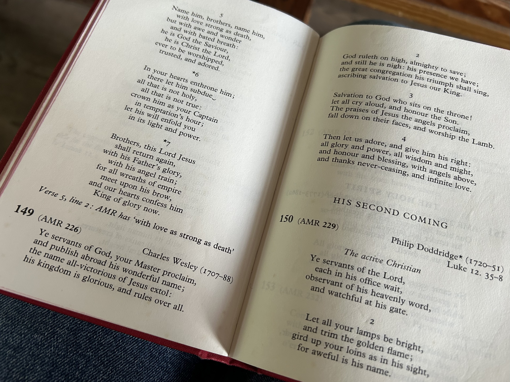

# June 2025

!!! danger  "Editorial efforts end here"
    - I have not yet had the time to do an in-depth editorial of the following sections in the timeline.
    - Everything from here is rough-sketch at best.
    - Please be patient while I work on polishing up these sections.
    - I will publish an update in due course.
    - If they ask you to pay for the update, contact me with confirmation you bought the book and I'll send you one for free.

## Detox

- Spies everywhere: woman bullied at work, over-chatty woman, etc.
- I'd be surprised if there were any normal people on this retreat.
- Just sketching now, will edit later

### Louis Theroux lookalike and his wife give me a hard time

- What a set up.
- God told me he'd put the wipes back, and where they were too.
- Extraordinary business.

#### Egg extraction obviously

- Events like the fasting retreat in June 2025 - ram packed with agents and intuitive industry specialists - also probably set up surgeries (my room mates were extraordinarily weird and unpleasant, and they had made the bunk bed I wanted to sleep in very itchy so I ended up having to sleep in the middle of the room where I didn't want to sleep - she was probably a surgeon).

### Daniels tells them to come to him if anything goes wrong

- So me finding out they'd been in my room (I could feel it, but then with the missing wipes, I knew and challenged him), was unexpected.
- The man (Louis T lookalike) says he's going off to see Daniel.
- My guess is that was the instruction if "anything happened".
- He didn't make it to Daniel, because God showed me where he'd put them and I initially thought it was my fault.
- If he had've made it to Daniel, would that've been murder time?

### Daniel talks about them in a group session

- We meet to talk about therapy, or something; oh yes, our comfort zones.
- Daniel makes explanations for their behavior. 
- She has said she's a CEO of a company and her comfort zone is being in meetings with colleagues.
- Daniel says later on about how business people operate in a tricky way, using people all the time, and I understand he's referring to her, and it does explain her behavior (Louis seems to be under her spell a little).

### I tell two spies what happened

- One of them is having a "hard time at work" with her favorite job she got and apparently enthused about the last time she was there - there's a lot of repeaters.
- And the other is too lively.
- It was weird, I told the lively one all about Louis's bizarre behavior and she was so excited to hear every word, oh wow, what a story, what happened then, so exciting...
- Then the other one wanted to hear it and she was slooooow, oh, ok,... oh... it was very strange.
- I think they were both spies playing their games with me.

### I write notes to them

- I start to write notes on a piece of paper in my bedroom to them, because I know they're coming in.
- Surprising notes of friendship and love.
- That didn't get through, did it :)

### Murdered by the gypsies in Madrid

- A therapist on the retreat is someone I know from the US trauma world.
- He was assisting at the Somatic Experiencing (SE they call it) trauma introductory course I went to in Edinburgh I think in 2017 but found it not for me - actually people had been particularly unpleasant towards me when I was looking for help.
- In February 2020 at TT in Cork, a woman tells me the man's son committed suicide.
- He doesn't tell me this when we have a chat but he does tell me his mother was likely murdered by gypsies in Madrid for her jewels.
- He told me that it had looked like suicide - head in the oven - and there was no investigation.
- I tell him I'm doing it all for her too, which I most certainly am if she was another mousse-patsy sent in and never expected to come out alive, like me - unless of course he was lying about his mum.
- I saw him in Glastonbury the last time I was there... when was that, oh yeah, while I was staying in another temporary mousse-operating-theatre in Dorset in February 2026... I was walking and saw him, but he kept his distance... very far off he was but I could see it was him.
- Incidentally, Levine's program is closely connected to the US military.
- Another incidentally, is that neither Levine nor Steve have set up any courses in England (I might be wrong about Levine), which seems strange. Always Ireland for Steve, and Northern Ireland/Scotland for Levine.

## St Michael's church Minehead

- The organist.
- The candle.
- The hymn.

- TODO:

## Writing to the Baroness, again

- wip

## Snout or world-saving lucky-frog-missus

- After a long time, I randomly do a google search on `1frgvn x` on my mobile.
- I see the following sole X reference as a result:

- This was a profile message from late 2023 or early 2024.
- There is very little else in results.
- Two days later, and this result is gone.

## My dad's a "legend"

- I take my dad to a gig where he plays piano.
- He's unstable on his feet.
- As he's getting up onto the stage, a man who looks a bit wild runs up to us.
- *You're a legend*, he tells my dad repeatedly.
- I think, at the time, it's because my dad is so frail yet still out and about doing his hobbies, except this wild man keeps looking at me in a strange way, snickering.
- I now think the man, like millions more, had seen the incest porn and was referring to my dad being a "porn legend"...
- I wonder how famous he actually is in porn...?
- Pretty famous, I expect.

## Jan Lovell blanks me at East Finchley library

- Who's told her I'm going to be there.
- Who told her to glare at me angrily and blank me when I mention my emails.
- Adams?
- Probably... little Lucyfer Adams was so desperate to meet me in January/February, and was so excited about showing me her new "girlfriend" who had put plastic down in front of a full length mirror beside a bed and was clearly about to self-harm for porn (I guess Lucy manipulating it all the way)... maybe even kill herself for the porn, who knows.
- Nice lot.
- Aren't they.
