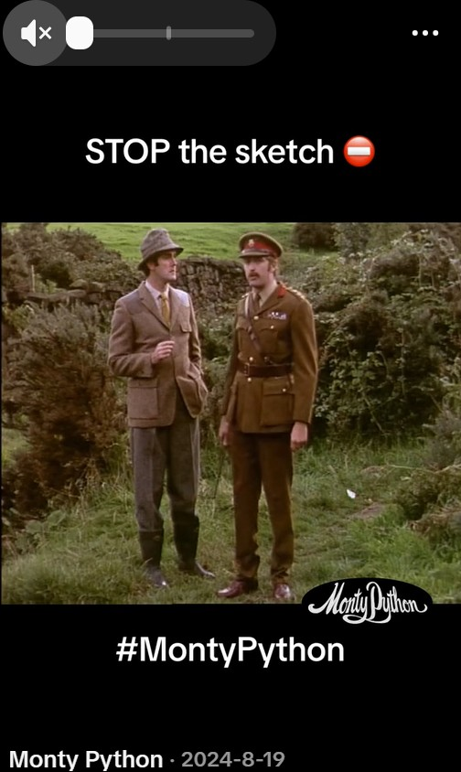
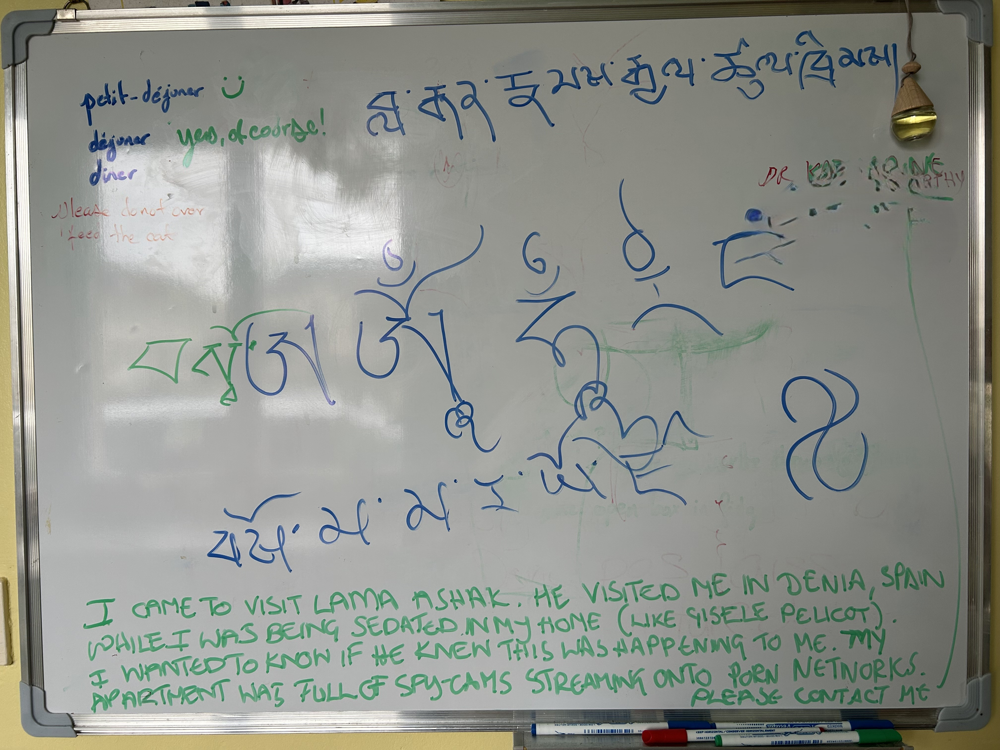
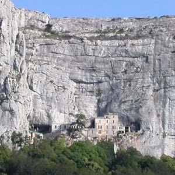
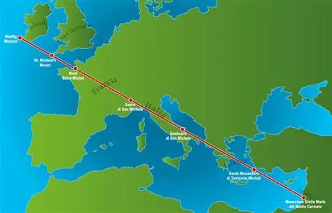

# February 2026

## Dorset continued...

### Andrew

- Was his wife called Sarah?
- He looks like King Charles and I'm getting masses of King Charles triggers the whole time I stay with them.
- Again, I only have warm feelings about the king.
- Again, I booked the place about three weeks in advance so they have had time to set up.
- They REALLY set up.
- Pictures, bathroom decoration, helicopter landing field, a fashion dummy male swimmer with black shorts head in the ground outside that looks like the `@jctot19` man, ... relentless.
- I don't know what to make of it because I don't know the truth yet about the Americans, but I'm very clear it is ALL FOR ME!

### Andrew is a photographer from Muswell Hill

- He was very keen for me to know this, shared his website, etc.
- I wonder who he really was telling this to.
- Does it mean he knows madam, Eddie, my dad, Kevin Joice, and Ray Archer personally from the rape-house in Queen's Avenue?
- Or is there some kind of internal secret service war going on between the perverts who are producing pre-birth porn and the relatively sane spies?
- I never met Kevin, wouldn't know what he looked like. My dad always said he had met me, emphasizing even. Of course I wouldn't dream of him meaning that the man had raped me while I was unconscious or that my father would even SAY something like that to me knowing that it had happened. Or Eddie for that matter. I only know madam from the hairdressers.

### Andrew wants to keep the porn

- I tell him what's going on for me.
- He's not surprised, or concerned.
- He asks me; *so what about AI porn then?*.
- I'm dumbfounded!

### Bridge

- Constant triggers about the bridge, and how I'm going to be rescued.
- Andrew is out in the helicopter field checking the ground every day.
- We're conveniently located next to RAF Yeovil so there are helicopters flying over constantly.
- I'm hopeful.
- No-one comes to rescue me.
- It's mental and I cannot understand what's going on at all.

### The room under my bedroom

- They have some contraption set up in here right below where I sleep.
- The doors have no locks and people can exit and enter anywhere they like with no problem.
- I'm starting to feel and remember these sedated surgery events to a tiny extent.
- I come away from this place believing they have medically scanned me because I survive poisoning and that makes me special.
- It's not this, they stole eggs to make babies.
- They may have indeed scanned me first - I guess they do that to check for viable eggs.

### My left ovary aches

- I'm reminded of Antonio all the time with the decorations, the pictures, and with the man upside down in the ground, I think they want me to believe he's dead.
- One morning, my left ovary is really aching.
- I tweet about it saying; *even just the thought of him makes my ovary's twitch*.
- You see, I've been sure we will have children for a long time, and the Bible confirmed it.
- I could not imagine they would have been stolen from me; it's just, not even a horror writer like myself could think something so despicable up!
- A big shock in Jerusalem was coming; thank God I was there with the Holy One, I would never have survived it otherwise.

### The persistent widow

- I'm prompted with this parable of Jesus, which is like a precis of my life these last years.
- It's reassuring.
- I realize the "widow" from this parable, refers to the "widowhood" mentioned in Isaiah 54, which is clearly also me.
- But I thought the children mentioned by Isaiah would be coming from me, in a normal way (apart from the age), because God has no limits, and that's why I think I could be pregnant now even though tests say I'm not!
- So just leave me alone please. It's enough.

### Andrew talks about sexual trauma

- I like Andrew.
- His wife seems not to like me.
- It is interesting actually. Quite often, the women are really sort of huffy and moody with me while the men are quite upbeat. I noticed this at the bring-and-buy sale in Bali too.
- Do you think it's because the women know what's going on, disagree, and can't do anything about it? Or have they lied to them about me with the trans thing or some other nonsense like they do in Lourdes?
- He wants to know about an old friend who went camping one summer as a young man and all of a sudden started to say aliens had landed and were controlling him in his head.
- I said if someone had come in and raped him violently, his mind might have only been able to deal with it by creating a story like this.
- Andrew was referring to so many things here:
  - The CIA in my head since 1989.
  - My PTSD reaction to severe sexual trauma in 1989.
  - How other people might react to sedated egg-extraction surgery - and I wonder if Brittany and other broken-and-robbed-vamosos are good examples of how the mind copes with what the "body" always knows, that one's very life-force has been ripped away.
- I wonder if "The Body Keeps The Score" author was targeted because he knows we always know. Did he know more?

### Israel everywhere

- They're pretending they're connected to Israel... I guess this was the first really obvious example of this and Loka Yoga was the most intense and extreme.
- I think Antonio is in Israel still, remember, so they talk about that a lot as if it's true.
- They also set up accounts pretending to be him and they give themselves away badly here because they always make him extraordinarily ignorant in tone, in a manner in which I know he could never be.

### CIA intuitive

- Someone pretending to be Israel online says I'm a CIA intuitive.
- I agree, yes I am, fatuously.
- Then say I'm not.
- I start thinking about this though, and it becomes a kind of reasoning to everything that's been happening and I talk about it repeatedly before I understand the truth which does contain a bit of this but A WHOLE LOT MORE evil.
- I think this was a way to explain things to me before they murdered me without revealing the horrible truth.
- Well God told me you miserable *********s (that's a word so insulting, it doesn't even exist yet).

### Threats online

- Threats with close proximity, however, continue.
- I have everything I own in my car. I packed the morning I left for Dorset.
- Their manor house is in the middle of nowhere and I didn't stop.
- In the boot, I have a fold up yoga chair and on top of that I put my Ikea pillow.
- While in Dorset, before I've gone anywhere, a way too close-proximity threatening fake account pops up.

- This comes directly from Andrew and co at the house - I guess a lot of people turned up once I was sedated after going to bed.
- My guess is that agents in the business a long time will recognize this sort of thing immediately, and likely confirm that whoever is stalking me relentlessly - clearly those who have the power to get nearly everyone in the world to do what they say - their intention for me is inevitably murder.
- I leave the UK on the understanding that I have zero human rights in the UK.
- On my drive to the boat at Portsmouth, I'm chased by fast sports cars with "significant" registrations down the M3.

### Dolphin

- I think there's a couple of criminal notables on the boat too.
- I'm sitting behind them at lunch.
- I'm sad and depressed. Actually really depressed.
- It's really difficult being a non-human with no rights but everyone seems to want *something* from you but won't tell you what it is and never offer a helping hand in return.
- It's getting overwhelming.
- I'm going into a poor-me.
- The woman who is with her father, shouts, and at the same time from the corner of my eye I notice a breached dolphin diving back into the water.
- It happened right beside me.
- Unprecedented.
- A sign from God.
- I go for a nap and get up and start writing again.
- My words are all I have left (who could imagine they'd even take my eggs!) so I'd better make them good.
- The man from earlier is sitting a little away from me, staring at me. He seems amazed.

### Prep for surgery

- I think I wore my nice grey winter boots a fair bit during this trip.
- I drove down in them, a good three hour drive, and I drove away in them too and wore them all day on the boat.
- I didn't notice the right boot was a size and a half smaller than the left until October 2026 when I wore them again and they were crippling, in fact.
- I must have been on some heavy painkilling medication and pre-op stuff I suppose, as well as the after effects of anaesthesia and internal surgery.

### Distraction from surgery

- They know money can be a weak point for me - I've stopped caring about even that now!
- They set up a situation which will bother me a lot to explain to me how I'm feeling.
- The tax office in Denia takes 6000 euros from my Spanish bank account spuriously.
- I believe this is on instruction from the Americans.
- In November, they try to take another 2000 euros but there is only 31 cents in the account.

### A BBC reporter from Panorama wants to speak to me

- Another distraction I'm sure.
- She's doing a program on the rape-gang phenomena.
- I have 2 minutes to tell her as much as I can about what's going on for me; I hardly take a breath.
- I start with: *this is the scoop of the millennia*, she laughs, and I say *no, really, it is*, and do my best to get my point over making sure to mention I have no human rights in the UK and I am seeking asylum in Israel where I'm safe.
- I never hear from her again.
- Another American distraction?
- If so, it's very ironic given we now know they instigated the rape-gang phenomena in the UK.

### The rainbow

- I guess this must have been after successful surgery, because God sent a rainbow.
- It covered the house like a picture postcard.
- Andrew took a photo of it and sent it to me on WhatsApp.
- It was extraordinary.
- I take it to mean, now I know what they were doing, that God is on my side even when I'm sedated, robbed of my children, and high on painkillers, and he's going to sort them all out very shortly.

### I throw the key away in Nevers

- For some reason, I walk off with the key to the annex house where I was staying (there's multiple doors to the building so it was just for show really).
- I realize in Nevers, I still have the key.
- I'm looking at it, in my hand, and I get an overwhelming urge (yes, one of those) to throw it out of the window. Which I do eventually because the urge is so strong. It's a God urge.
- I tell Andrew I did this when I'm in Milan.
- It's so curious. I have to wonder about this.
- And I do wonder if it means they threw out the surgical implements and some nice kind person picked them up for safe keeping, and it wouldn't surprise me God's so much on my side and always has been and always will be!
- <3

## What, wait, another (fake) collapsible bridge again?

- Ask me the questions, bridge-keeper. I am not afraid.
- What is your favorite sport?

- Golf.
- It's the wrong sketch. It's a full body scan.
- Aaaaaaaahhhhhhhhhhhhh.
- The fact that Monty Python is a Great Ray supporting Merry England amazes me.
- There must have been so many quadrillions of prayers gone up.

## Shenten in Blou

- I visit the Shenten monastery in Blou to see if my old friend the Tibetan monk is still there.
- You may remember [the monk who came to visit me in Dénia in 2023](../2023/september.md#the-tibetan-monk-visits) when the porn gangs were panicking - and telling me everything incriminating - because I had not behaved as expected.
- It is highly likely that, at the time of his visit, they were still coming into my apartment after I had been successfully sedated on going to bed.
- I didn't know any of this at the time, of course.
- When I did realize I had been drugged continuously in my home in Spain, I tried to talk to my Tibetan friend about it.
- I emailed and texted him a good few times.
- He blanked me.
- He stopped responding to me the moment I mentioned I found out I had been drugged.
- It's curious the way men do that - then loudly tell you it's nonsense - as if common men would never do such a thing! 
- (See, for example, Gisele Pelicot, and the monstrous common men who think porn is normal).
- Anyway, I thought I'd pop into the monastery to see if he was there.
- He wasn't. 
- In fact, no-one was there so I left a message on the kitchen whiteboard.

- Then it turned out they were all at lunch so I ended up speaking to Lama Gelek and Lama Lagen who run the place these days.
- I told them the whole story.
- They say they're sorry it happened and then they say that thing where you don't count as human, never mind vulnerable and worth helping: "You must forget the past and go on from here. Past is gone."
- I say: "If vulnerable people, children, are in danger, you have to do something."
- Lama Gelek agrees.
- I explain: "That's why I'm here".

## Wednesday 11th 

### The first apparition of Our Lady at Lourdes

- Me and ChatGPT chewing the cud on what the dark forces might do when they realize that the beautiful piano player's true husband is not the gypsy trumpeter after all.
- He is, in fact, the Holy One of Israel.

- We suspect they'll get very cross, again.
- One of the most miraculous Great Ray type things is how the Bible supported my beliefs, even when I was believing the American and UN lie that my love was in Israel.
- Don't you think that's just spectacular?
- I can tell you, we've not even got started my love, and when we do, it's gonna be the good stuff, none of this wading around armpit deep in everyone else's muck, no.
- Something I don't yet have words for.
- Will you come with me?

### Dinner with the Sisters of Nevers

- I buy a ticket to have dinner with the Sisters of Nevers to celebrate the first apparition of Our Lady to Bernadette on 11th February 1858.
- One of the nuns sitting diagonally opposite me looks *exactly* like Margaret Rutherford.
- I tell the German nun sitting opposite me and they all look her up on their phones and agree.
- I make sure to tell them that Margaret Rutherford made the best Miss Marple of them all!

## Sainte Baume

- It feels like the end of a major cycle.
- I'm back in Sainte Baume after four years of hell at the hands of the porn gangs of Dénia and their international co-conspirators.

- They never expected me to survive.
- They never dreamed I would not only survive them, but end up telling everyone about them, and so much more.
- Do they think the world will not be disgusted and appalled with them, devastated and mourning?
- Should they have just let me play the piano in peace?
- Have they sent their operative(s) out to Sainte Baume again to check up on me (or worse)?
- Seems I can rely on God to deal with them.
- Correct me if I'm wrong but French military students were sent to guard me while I was there, as was a British spy (amazing woman, just adore her, red hair, can't remember her name, brother went to the pedo-Catholic school in Yorkshire), and a couple of Americans as usual, and a pornographer! Why not just throw in the pornographer while you're at it, ay?
- [Isabel was there too](../2022/february.md#isabel-pilgrim), sitting with the military students. 
- I think there was something going on re "investigation", she was so angry with me.

## Dangerous driving in Italy

- I don't know if this is common in Italy - it seemed to be from my experience.
- I'd be driving along the motorways feeling quite anxious actually. 
- I felt especially unsafe driving from Padova to Milan and I think what I'm about to say happened three or four times on that specific trip.
- There'd be a line of lorries in the next lane I was about to overtake.
- Suddenly the one at the end would lurch out into my lane, without indicating, and THEN put his indicator on.
- It was terrifying; a bunch of near misses.
- Could that have been intentional, or is it really normal over there?
- It was not just that stretch of road, or on the one day only.

## The Name of the Rose

- The monastery at Sacra di San Michele near Turin was the inspiration for the novel *The Name of the Rose* which became a film starring Sean Connery and Christian Slater.
- The monastery is a significant site directly on the Sacred line of Saint Michael that traverses from Ireland through England, France, Italy, Turkey, and ends in the Holy Land at Mount Carmel, Israel.

- I like to think he detours to Glastonbury and Burrow Mump, and why wouldn't he...
- Anyway, after visiting [the holy site where Mary Magdalene spent the latter part of her life in meditation at the grotto of Sainte Baume](#sainte-baume), lifted by angels seven times a day to greet the sun, I'm currently highly sensitive to Magdalene themes.
- I was drawn to Turin by the Shroud, of course, and only on arrival found out about the monastery dedicated to the boss, my task-master.
- Anyway, back to the film.
- So, the film has huge Magdalene themes running through it, unintentional or otherwise; the main one being the true love affair the Christian Slater character has with the destitute woman who is forced into prostitution and ends up being condemned to be burnt at the stake by the monks.
- The beautiful, wild woman in the novel is the eponymous *rose*.
- The symbolism of the Catholic Church's poor, at best, treatment of Mary Magdalene for two thousand years is obvious, at least to me.
- The boy I lost my virginity to in 1988 took me to see that film at the Phoenix in East Finchley.
- It was the first adult film (15) I had ever been to.
- I was 15, in fact. 
- He was 23. Simon. His hobby was photography.
- For some reason, me and my friends were obsessed with losing our virginity.
- It was an urgent message we were hearing everywhere; something we must do as soon as possible, or else!
- We read it in our magazines, we heard it in our gangsta-rap; it was inordinately clear what we had to do, and as soon as possible or we would just be nobodies!!!
- And, there was no alternative either.
- So, being a high achiever, a go-getter, quite competitive really - and having no idea that I was being manipulated by the patriarchy in it's most sinister porn-addict form - I sought to do what I believed was going to be good for me.
- I vomited all night afterwards.
- Simon took some nice black and white pictures of me one afternoon in Hampstead, developed them and printed some copies.
- It was the year of the Lockerbie disaster and the year before the North London rape gangs got hold of me and took my life from me.
- And, a very very curious thing is... the picture I always saw myself and Hazel Smith in that popped up during the Dénia porn-gang online (and otherwise) torture... this one:

- Well, the *me* I see in it is that picture Simon Gaskin took of me in 1988.
- Winston May had a copy of that picture.

### Groomers

- Back in the 80s, just like today, there were adult-male groomers in every town, village, and suburb of big cities looking to manipulate youngsters into having sex with them.
- Simon Gaskin of Garden House, Grange Estate N2, and amateur photographer, may have the largest and significantly psychopathic collection of porn.
- Another male (sedated-rape/pedo) porn-addict network running parallel to the mainstream one my dad was a member of, or did they know each other, or are these networks one and the same?
- In Simon's case, he would have been alerted to the fact I had seen him and thought he was cute via one of the most egregious groomers in East Finchley, Richard Reid.
- Simon introduced me to his "friends" who we might me out sometimes, nothing sinister I thought apart from the snickering and leering at me. One of them was called "Spider" and we met him in Hampstead High Street one Saturday afternoon. Was Simon marketing?
- Simon's friend Richard Reid of Hertford Court, Hertford Road (at least his mum lived there) befriended girls aged 12-14 and had a "girlfriend" who was 18.
- Willow met Richard often and was introduced to his dad once.
- Even in my twenties I saw him sitting out on summer evenings on East Finchley High Road with schoolgirls.
- His mother was so angry that he was bringing all these little girls round to her house. But she never stopped it, she just scowled at us.
- Back in the day, it was a free for all and we were the naive and impressionable opportunities.
- Richard had already befriended Willow, a friend of mine, through her neighbour Tyro Harvey (son of a famous rock star) who was also much younger than Richard, but older than us, and as equally impressed by him as we were.
- They would hang out in Cherry Tree Woods and approach children.
- Everyone looked up to Richard; he had puff and he would share it around.
- He would then arrange for us to hang out with him, and we would go somewhere in the back of his little white Computer Centre van, and we would smoke pot together and giggle.

- It was only a matter of time before one of them had sex with one of us.
- I believe these men connected via their shared interest in under age girls, compared notes, and divulged information about the girls they had persuaded they were safe.
- Richard would literally have three or four underage girls in the back of his van and he would take us around to show his other mates in the area.
- Did they respect him more for it, or was he doing it for "casting" purposes?
- Richard even made it into my [2015 police statement](../2011-to-2020/2015.md#statement-to-the-metropolitan-police) he was such an obvious perv.
- Porn was always lurking in the background, mentioned within earshot amongst the men.
- While I was seeing Simon, he kept mentioning porn.
- He had a friend who he hung around with who lived down on Falloden Way in Hampstead Garden Suburb over a shop with his mum, Victor!
- This friend's girlfriend, Simon would tell me excitedly, did porn.
- I didn't know what he was going on about.
- I was 15, remember.
- He then showed me some porn one evening on VHS.
- I just thought it unbelievably boring and wondered what all the fuss was about.
- My disinterest must have been obvious because he never mentioned it again.
- I bumped into him a few times in East Finchley in the 90s.
- The way he spoke to me made me realize how little he had thought of me when we were together, and still did.
- He spoke to me if I was an idiot, and he seemed to delight in it too.
- I remembered that he had always spoken to me like that, as if I was beneath him by about a million miles, but I hadn't been mature or experienced enough to know how to respond to that sort of disrespect, so I always just stayed silent and wondered if he was all right in the head.
- I did beat him at chess a lot when I was 15.
- I bumped into his mum about twenty years later, and his mum did that thing mum's seem to do to me and she persuaded me to go and visit him.
- I did.
- I popped around to see him for about ten minutes.
- I didn't want to sit down. 
- My feet seemed to be sticking to the floor of his bedroom.
- The smell of dry semen was overpowering.
- I think his porn addiction had completely destroyed him.
- Did porn-addicts back then collect and share the girls around, like football cards?
- Did the picture he took of me end up at the Red Lion criminal-porn headquarters in High Barnet?
- Was the Tottenham rape-gang contracted to target me and my friends, knowing at least I was already sufficiently groomed to be easily lured into gang-rape situations, sedated or otherwise?

## Keeping me topped-up in 2025

- Something was keeping me high throughout 2025, and I have the [DESO account](https://desocialworld.com/u/KingForg) to prove it.
- Obviously, the gangs had a strong motive for keeping me high which was to keep me oblivious about the trumpet teacher being made up of [a number of distinct and different looking men](../../crimes/protagonists/vidal-sastre.md#seven-devils-and-one-angel), that I even had photos for!
- There were some obvious incidents like the [Cambridge ugly ladies](../2025/april.md#shoe-zone-harlow-essex) last April, and [July's murder attempt](../2025/july.md#lourdes), but I'm still without an explanation of why I was high *all the time* in London throughout 2025 until [I remembered the switcheroo](../2025/october.md#thunderbolt-clarity), at which point it stopped.
- If the porn-gangs own my brother, as I suspect they have done since his Thailand episode, could they have involved him in some way in maintaining my confused mental state while I was living at 31 Trinity Road N2?
- Is that why Paul was so *keen* [to become his mentor](../2025/february.md#paul-and-my-brother)?

## A Paqui-Fornet lookalike in Padova

- I visit Padova for a few days at the end of the month.
- I need to buy a towel for my trip to Israel where I intend to sit a Vipasana course at the Sea of Galilee center.
- I go to the department store, Coin.
- As I'm going down the stairs, a woman is striding up past me, slowly, deliberately, so I see her very well.
- She looks *exactly* like [Paqui Fornet](../../crimes/protagonists/domingo-et-al.md#paqui-fornet-pastor), pedophile-porn-studio manager.
- I'm not sure why this sort of thing keeps happening repeatedly.
- It's clear to me someone is *arranging* these lookalike events but I'm not sure who, or why.

## Who are the Salmon Mousses?

<iframe width="839" height="472" src="https://www.youtube.com/embed/7m1SXSdeWVY" title="Monty Pythons The Meaning Of Life - The Salmon Mousse" frameborder="0" allow="accelerometer; autoplay; clipboard-write; encrypted-media; gyroscope; picture-in-picture; web-share" referrerpolicy="strict-origin-when-cross-origin" allowfullscreen></iframe>

- The Salmon Mousses have obviously been all over me since November 2025, but I was suffering with [the revelation about my father](../2025/october.md#my-father-the-pervert-amongst-all-this-other-horror-as-if-there-wasnt-enough-already) so had other things on my mind.
- I may have mentioned them on X back then, but my account is unsearchable as I mentioned, so it's difficult to pinpoint the first time I used this title.
- This month I start to realize they've been all over me for months and consciously notice them everywhere I go.
- Just like at the conservatory in Dénia, I'm the star of multiple, intricate, choreographed and staged theatrical snippets, the meaning of which is usually anyone's guess.
- They're behind everything aren't they, every tiny evil machination, and all the giant ones too.
- I'm 100% clear on this, the clarity has been a miracle of healing. 
- I pray God can forgive them. I'm absolutely sure He's not going to let them off.
- I'd have survived that dinner then, perhaps that's the WHOLE POINT OF THE MEME! Hooray!!
