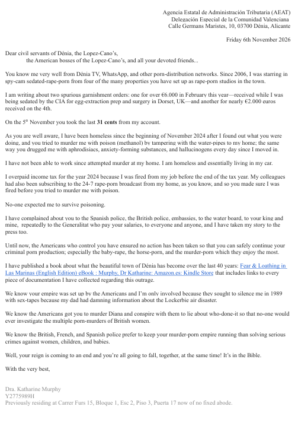

# November 2026

## Dénia tax office steals more money from me

- In February 2026, while my eggs were being stolen by secret service porn-addicts for their pre-birth porn and clone-your-favorite-victim program in [Dorset by a secret-service porn-apocalypse operative](february.md#andrew), the Americans task the Dénia tax office to rob me of 6,000 euros.
- They do this to distract me from what's really going on at the mansion in Dorset, which they are not doing much to hide.
- For some reason, they decide to do it again at the beginning of this month, attempting to rob me of a further 2,000 euros (I wonder if these sums go straight into the Lopez-Cano bank accounts).
- Anyway, I write a response to them.
- Here's the letter:

- My N26 account has only had **31** cents in it since March.
- I always found that interesting.
