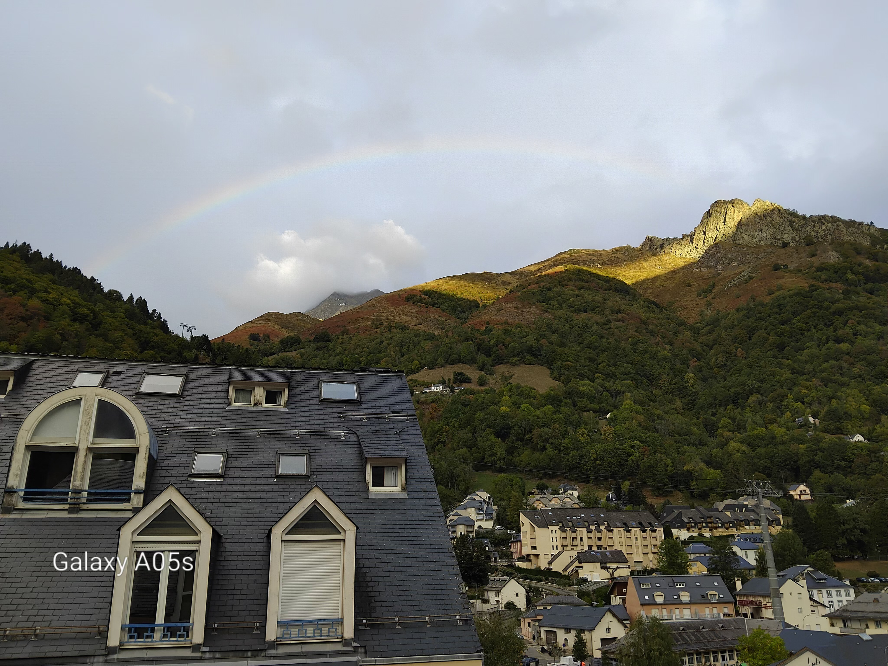
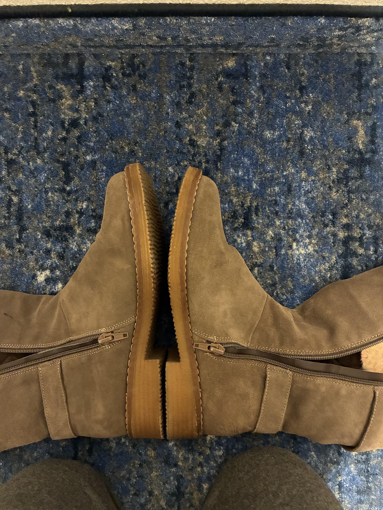

# October 2026

## Cauterets

- Unfortunately, this is a pre-booked apartment and they've had a long time to set up.
- I see them going in to take down when I leave; and some personnel leaving at the same time as me.

### The Cure

#### Poisoning and sedated surgery, again

- For sure, they accessed my belongings in my car parked in Toulouse and added some poisons in there, I think I wrote about that in September.
- Looking back, I was a bit high still there so they were still affecting my thinking processes.
- They sedated me too, and did something, I don't know what but I seem to have a keyhole scar under my left armpit.
- On one of the first nights there, I woke up in terror and ran out of the bedroom and slept on the sofa.
- I did that another couple of times too.
- I had a weakness in my left armpit breast side, and my breasts became very large - this is a symptom of CO2 gas to the chest cavity.
- I guess they film everything and we'll find out.
- It was very stressful though and I ended up opening all the curtains before bed so that everyone across the road could see what was going on and film it.

#### Stefan is filming me

- My first morning of soins, I have the hose.
- Stefan one of the staff at the cure is doing this.
- He is wearing his phone around his neck and I realize later he's probably filming me.
- The hose goes on the left breast area and whatever they were doing to me while I was sedated in the apartment snaps.
- I'm injured, again.
- I can hardly pull myself out of the bed for the pain.
- It last about a week intensely.

#### He sends rainbows

- One morning after all this, he sends a rainbow to reassure me.

- The amount of rainbows he sent on 13th June 2023... they were ALL OVER the town of Dénia and Las Marinas.
- Then again when Nadim was bullying me like crazy at Polygon in November 2023, he got fired - or they called it off rather cos they saw I was onto him - and the rainbow came.
- And then I started to remember other significant rainbows.
- One was when I returned home from Madrid in I think July 2006, and I was devastated (I think there must have been a massively brutal attack on me fairly recently at my flat in Boadilla, or perhaps somewhere to do with my Hot English job, or perhaps in a hotel along my route up through France), there was a rainbow as I came into Dover on the ferry.
- The following morning I chain-smoked about twenty cigarettes at the kitchen table while sat with my mum. I haven't done it before or since. I thought it was because of her. It wasn't at all, was it.
- I was at Chartres the night before and there was a man I felt exposed to somehow in the restaurant.
- I bet it happened all the time, to my mother too in Saint-Malo, I heard, when she was with my dad on holiday.
- My dad had been going there since he was a young man. I think he set my aunt Bernadette up who was sexually assaulted/raped on a trip to France when she was 16 and never recovered from the trauma.

## Lourdes

### In the trenches

- I'm writing messages and getting answers in the street, like usual.
- My social media activity seems to be a meeting point for numerous interested parties and I start feeling like I have friends all over the place; wolves, lions, snakes, as well as sheep, kids, and children.
- This is good.
- There must be a defined split of who could even tolerate egg and semen theft for the elite.

#### Trump

- wip

#### wip more 

- see emails to myself

### Guruji's stolen children

- I realize that Guruji is like me; except because he's a man he has thousands of stolen children it's that much easier to steal the creative life force from men.
- This is why [God showed me the universe shawl in the tunnels](../2025/august.md#alma-and-i-go-to-the-tunnels) that I saw [given to Mrs Guruji at Parmarth in March 2026](march.md#sadhvi-bhagawati-saraswatis-shawl); to connect the dots.
- Thousands: as many as the leaves on a tree.
- The wealthy and privileged gone totally mad.

### Writing to myself

- When I start to serve Our Lady, my internet access is very intermittent so I start to write emails to myself on my phone about things I'm thinking.
- I get responses directly to these emails from people in Lourdes; usually in the restaurant or in the sanctuary itself.
- This MUST prove American fielding of my emails down to trusted hospitality members who then share information with others requesting them to bully me and "say things"... etc.

### Everyone knows who I am 

- The sedating-rapists have been warned long in advance I'm arriving.
- My room in Lourdes hospitality accommodation is 108.
- Everywhere I go, people are whispering and pointing.
- I know they're mostly being lied to about what makes me so famous - they're being told it's because I disagree with transvestites working in the baths, part of an email to myself.
- I expect only all the men and a few women know the truth that it is to do with the sedating-rape epidemic - the Abomination of Desolation in the holy place - so when women come up to me and respond to things I have said online, I know they're not getting the full story because it would END IMMEDIATELY if it wasn't just one lone voice in the wilderness, me.

### Jonathan, Alletru, others...

- They quickly tell the people who DO know that I'm here.
- My location is pinpointed, as usual, just like it was with the porn-gangs of Spain.
- Jonathan pops up - I had no idea Jonathan was involved but I always thought he was a porn addict from the way he spoke to me.
- And then I start to remember weird things with Jonathan from right back when I met him in 2014 and ongoing through to 2021 when I lived there.
- They tell a woman, Alletru she calls herself, I'm there and to go sit next to me at dinner - in a completely empty restaurant.
- I look at her. I recognize her.
- She's doing her week's stage, second year, so I work with her in the baths.
- She speaks, and laughs. She sounds EXACTLY LIKE Sandra Diaz.
- I look at her more closely.
- She looks like Sandra Diaz (Benedetta) also, enough to be her/his mum.
- I remember being sedated/drugged with Sandra (she did this all the time, a little bit like Zoe, a relaxant to make you confident, and then she overdid it a few times, this instance I remember being really under consciousness, like deep down, far away, and annoyed too) and her introducing me to her: *everyone thinks she's my mum we're so alike*, she says. I think we were in the sanctuary outside the restaurant one evening after dinner.
- I realize Alletru is a phoney name and not a very good one either.
- She is all over me until I make it very clear I know who she is and then she backs off a bit. After I ask her if she has a child called Benedetta, I don't see her again.
- Another woman sits with us, a Venezuelan living near Saint Jean de Luz (remember Sandra recommending I go there and visit, which I did, and I believe I was sedated-and-raped there).
- The Venezuelan seems angry with me. I wonder if she's a link in the supply chain and if they're feeding vulnerable women into sedating-rape-porn traps, and more.
- These two sit with an elderly friend of mine who is vulnerable, and I don't like it - remember Benedetta was grooming the French pensioners in the choir in 2023/24 the last time I saw her/him. 
- I bet she's a transvestite. It would be poetic.

### My last night in Lourdes

- I go to bed. 
- About half-an-hour later I wake up with SEVERE cystitis.
- It's as if I've been raped violently.
- I haven't had cystitis since 2016.
- I remember my mum used to get it whenever she visited me in Dénia.

### Restoration/cleansing of the sanctuary

- I've done something good; it's not clear what, but something big enough to get me "punished" on my last night for sure.
- I urge the team to check for any men reporting their penises falling off in Lourdes over the last few days and you'll have him/them.

### Boots

- So I bought two pair of Hush Puppies boots last year in London.
- I decided I was going to wear the grey pair as they're winter boots and it's getting cold and I like them.
- So I got them out and put them on.
- Instantaneously I realized the right boot is a size smaller than the left - and considerably so.

- I wore them to dinner.
- It was excruciating. My right foot felt like it was in a vice.
- I couldn't believe it.
- I wore these boots all the time last year when I was in London, and I didn't notice.
- This means I must have been on quite heavy painkillers for most of last year - which makes a lot of sense given the repeated sedated surgeries.

