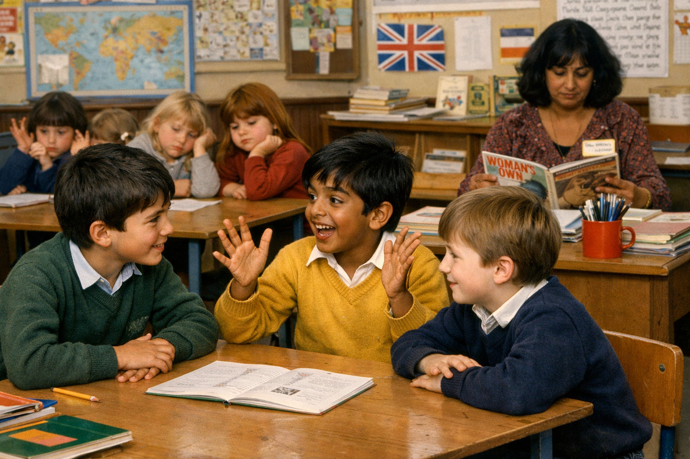

# 1984

## Abid Khan tells the class about the criminal porn his big brother shows him

- He's shouting now.
- "She was in a field with a pig", he declares.
- Tasos and Paul are animated and excited.
- Tasos tries to top Abid with the porn his big brother has shown him.
- "There were six of them", he says.
- Abid shouts louder still.
- I'm horrified.
- I feel a dark coldness come over me from head to foot.
- All the girls are quiet, looking down in silence.
- Something's very wrong, but we don't understand it.
- He's talking about snuff now.
- "Snuff, what's that?", asks Tasos.
- "You haven't seen snuff?", jeers Abid, "you're rubbish Tas".
- Tasos looks ashamed.
- "It's when they kill them, I saw it yesterday, blond lady, same field as the pig."
- Abid is triumphant.

- In 1984, eleven-year-old boys were already consuming murder-porn.
- 42 years later and men are still desperately protecting their beloved porn.
- Dénia was a disaster waiting to happen.
- See also trans ideology, male-suicide rates, low birth rates, end of the world, etc.

## An unusual story

- A substitute teacher comes for one week while Mrs Mulchansingh is away for some reason.
- It's close to the end of the year, when we'll all leave the relative safety of our primary school and head off to secondary schools.
- He's quite an interesting fellow this teacher; he worked at the BBC and he has lots of stories about that which we find fascinating.
- We're tasked with writing a story about something, I can't remember what exactly, and then we all have to read our stories out to the class.
- We never did anything like this before, it's all new, and I'm inspired and motivated.
- As an anxious child that was bullied a lot over the years I rarely speak up or say anything in class.
- I read my story out.
- I never wrote a story quite like this one either.
- I can't remember the bulk of it but the ending had me chopping all these men's heads off! 
- Kali-styley.
- I surprised even myself.
- The whole class was shocked, as I never speak! And then when I do, it's chopping heads off!!! :D
- Maybe I was channelling a little.
- I'll do an AI pic of that one shortly.
