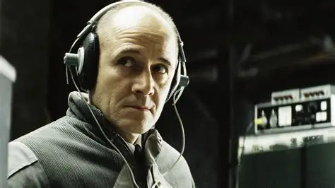

# 1989

## Sullivan

- It's January and we've just buried my aunt Geraldine.
- My mum has offered to feed everyone after the funeral.
- There are *hundreds* of people in our house that day.
- I'm upstairs hiding from it all.
- Dad meets a man called Sullivan; a man who works/had worked for Pan Am in a management role of some sort and knew Geraldine well.
- Dad recognizes him from something his sister Geraldine had told him in the past.
- She had told him that Sullivan brings the big black bag onto the plane at Heathrow, she takes it and keeps it in the office, he doesn't get on the plane, and it's picked up in New York.
- My dad remembers what his sister had told him as he's talking with this man Sullivan in our dining room - or maybe he remembered this detail after meeting the man.
- You can ask him about it.
- Dad told this story again and again, to everyone, and still does.
- He also always said that he *felt* an intense negative energy emanating from the man that made him firmly convinced that he had been involved; not cold, that was my mistake.
- Did he say he thought it felt like guilt?

!!! tip "The Lives of Others"
    - Did someone wearing headphones delay him, so it wouldn't end up like Air India... and he wasn't supposed to know, but he knew...

    

    - I met some families of the Air India disaster [the last time I saw guruji in Rishikesh](../2011-to-2020/2019.md#hanuman-puja-with-guruji-in-rishikesh) in October 2019.
    - We were chatting and they said they went to Cork every year when I told them I was due to go to Cork in February, so that's why they told me their story.
    - ...and then they went a bit quiet on me.
    - Incidentally, this film was one of [the first attempts at communicating](../2023/may.md#twitter) squirrel made, or perhaps one of the first that tried to warn me about the constant monitoring.

- Whenever dad tells anyone about this, he starts off with the energy-emanating part of the story before retelling what Geraldine had told him, as if this had been the bigger, more obvious thing in his mind.
- He told this story to so many people, I guess without realizing the implications of it, and then over the years he got lost in his overwhelming hatred... or perhaps was primed a little and it wouldn't have taken much.

### The ramifications of Sullivan

- A "little knowledge" is not dangerous except to the ego.
- Sullivan would have been enough here, after my dad going on about him - and my dad goes on and on about things - right after the funeral in Januay 1989...
- That would have been enough to get us all targeted for "silencing", wouldn't it, except Geets made 2 errors.
- First, she didn't realize they'd target all of us (me the worst), all the white girls - at least three of her close friends - and second, she didn't count on my dad's connections to porn (did he see me immediately in porn?, hence the snickering whenever I came home) cos something spooked her probably in.. hmm not sure maybe the winter of 1990 and she and her uncle created this whole "drama" of where she had been targeted and robbed .. and she was very keen I knew about it (the woman couldn't talk to me without insulting me, and suddenly they're sitting me down, telling me this whole business, carefully, making sure I hear it, all the details, bringing me along for the fix, to her uncles house, and I always thought, why are they telling me all this, they haven't spoken to me like I'm human in months - severe PTSD time) well, it makes sense now, as does her shaking at the GE.
- So it was all such a mess, and getting messier and messier, they thought up something even more evil to distract everyone from it but more importantly to threaten the country in perpetuity over it... silly woman, what was she thinking.
- Moses put the cat amongst the pigeons, didn't he.

## Hillsborough

- todo

