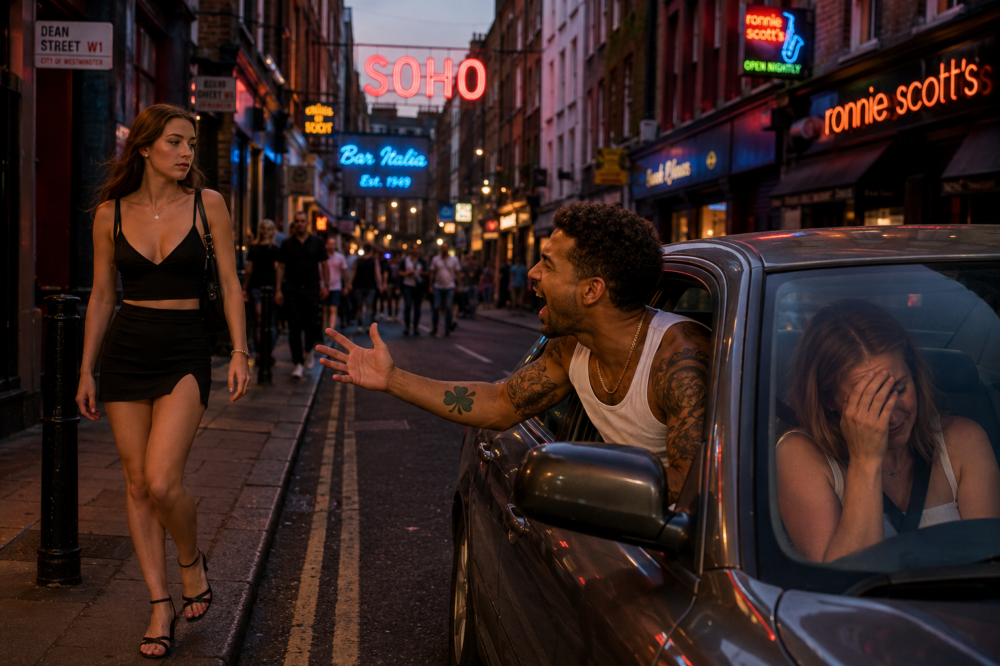

# 1995

## Carl Brian, Bobby and Steve

- Carl was in [the N8 band](1990.md#carl-brian) I described.
- The band doesn't meet anymore, I don't know what's going on with any of them.
- I do still see Chris now and then.
- I'm working in Westbourne Park/Ladbrooke Grove with Hammer & Tongs, Gavin Piggott, all that lot.
- Chris meets them all because I invite him to accompany me to one of the parties in West London that was on that my workmates invited me to.
- I haven't heard from Carl Brian, at all, since 1991.
- Out of the blue, Carl phones me one evening, says some producers want to meet me, want to hear me play keyboards.
- He's making it sound like an audition; I think he may have even used that word.
- So he picks me up from Canalot in his car and we drive down to Soho to Bobby and Steve's studios.
- All the way down, Carl is leaning out of the car window hollering at women.

- (He was driving, prolly was his best friend's ride tho).
- I'm embarrassed.
- We arrive at the studios and I'm left alone in a room somewhere for about half an hour; *wait here* Carl says.
- Carl comes back with Bobby and Steve and they ask me to play something.
- I think I play my bossa nova, the only thing I can remember (I need sheet music usually).
- It's quite good.
- But they're snickering, all of them, the whole way through.
- One of them is full out laughing.
- They tell me to stop and leave the room.
- I can't figure out what's happening but it feels horrible.
- For me, writing this now, this is a gauge on how famous I was already in 1995.
- I felt like a freak on display.
- Could something else have happened that evening I'm unaware of?
- I never heard from Carl again.
- I'm angry and offended by this event and tell Chris Ludwick about it.
- In retrospect, I think Carl might have been looking for drugs money and using me for that purpose.
- He was erratic and intense and the way he was shouting at women in the street from the car was unhinged.
- I wonder if Bobby and Steve told him to get lost, so he decided to try something else.
- He said, I have to go and visit a friend, will you come with me and then I'll take you home, he said, and I agreed, so he drove up to South Tottenham somewhere and left me in the car while he went into a flat for about half an hour, or more, as if I was a an object he didn't think much of that he'd forgotten to take in with him.
- I was offended.
- I never heard from him again.

## Sam Meadows

- He will tell the truth, and he knew in 1995, because everyone knew.
- We were an "item" for a short while, and we really connected well, and then someone must have told him about my rape-porn stardom, and he dropped me, utterly. It was horrible.
- He tried to be kind about it, but he wouldn't tell me the truth either.
- For Christmas 1995 he bought me a book about a man who was in a coma for a long time, and memories, and things like that, very interesting.
- He also made me read a book, Perfume, even more interesting.
- The whole thing upset him. He won't lie.

### Even more interesting than that is...

- I was warned off him, online, by hackers.
- How do I know, I was living in Lourdes in 2021, feeling really isolated, thinking about the past, and I tried to find him, again and again and again.
- I'd contacted another old boyfriend Ben Webber just before about Winston May saying some horrible things to him on the phone - but he didn't want to talk about it.
- So I was trying to find Sam, I looked a lot, over a few years actually, and eventually - after a hundred goes at searching for him in a million different ways in Lourdes - they popped him up on LinkedIn, working as a toilet cleaner!
- Hmmmm. Interesting, don't you think.
- He won't lie for them.
- He may well be a toilet cleaner too, nothing wrong with that. But it would be so interesting if he wasn't, don't you think.
- He was a potential outlier, someone who knew everything, knew Matthew and what he was capable of, and who knew what had happened to me... someone who might pull me off being lured back to Denia by the Americans, and brain damage, and sedated rape-porn stardom, and all the rest of it.
- His brother Joshua will also not lie. And can verify my brother's unfortunate evil nature too.
