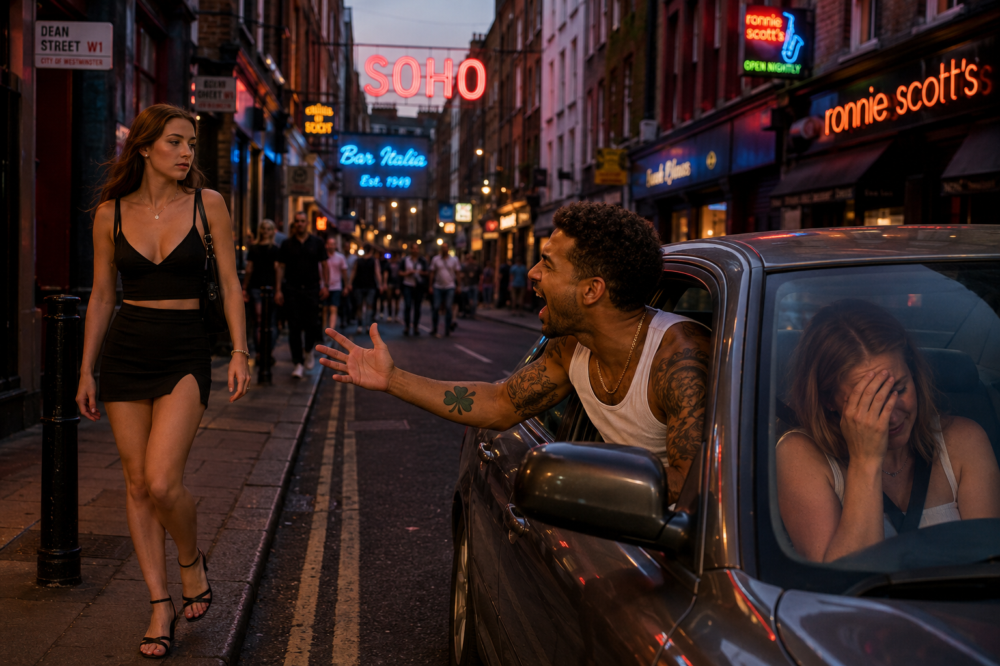

# 1995

## Red Star Films

- After my degree I was on the dole for a short while and then I signed up for a government scheme which put graduates in work placements in the media.
- I interviewed with John Freeze in Soho. Another boy in my class got that placement. I think he was called Andy.
- I interviewed at Red Star Films with Gavin Piggott, Nick Goldsmith, and Garth Jennings and got the job as a runner on £35 a week.

### Gavin Piggott

- Gavin was the boss. He had a beer-making? brother in the West Country and a very traumatized sister who may have been called Vicky.
- I used to arrive earlier in the morning than everyone else and sometimes have to clean the coke up off the tables.
- Gavin invited me to a couple of parties nearby.
- I took Chris Ludwick to one of them.
- Another I took Jen to and we ended up sleeping in a friend of Gavin's, the Aussie barman's bed with him, the three of us, afterwards: completely innocently (as far as Jen and I were aware).
- There was a weird business with a male (apparently) friend of a director Katie who was making a film about a new upcoming band. They had both studied at Hull University. Jen, myself, Chris Ludwick, and this guy and his friends went out a few times.
- Katie ended up marrying someone famous who died (I have forgotten her surname but I did remember it once).
- This is the famous "Chris's nipple" event where he had his shirt buttons open and it was a bit gross and we took the piss.
- I left the company in September or so of this year and the following year I started to work for a letting company in Finchley Central.
- I'd field calls from potential renters.
- One morning a woman phones up and she's interested in a property in Ladbroke Grove.
- She gives her phone number as the Red Star Films number and I recognize it and say hi and tell her who I am.
- An hour or so later, I pick up the phone.
- It's Gavin. 
- He shouts "slut" and puts the phone down.
- I'm shattered by this, I cannot understand it.
- I explain it to myself as having to do with Winston May's activities in 1989 and probably Arul told his girlfriend Jessie Brough that I'd been targeted by him.
- Jessie worked for Gavin from time to time as a clapper loader.
- Arul definitely told Jessie something evil about me as she turned on me most horribly.
- Jessie ends up going out with Garth and it's quite serious.

### Ewan MacGregor

- They were making a short film written by Barney Stoppard, Tom Stoppard's son.
- Everyone worked for free.
- Ewan MacGregor was starring and there was a shoot one evening in Milton Keynes.
- I brought Ewan his vodka.

### John Freeze

- I bumped into John Freeze in Ibiza on holiday with my friend Jen in September.
- Jen was sick with the flu and I ended up going out alone and met them at one of the clubs.
- I saw Andy and John and had known them already for about six months.
- Matthew Copeland new John Freeze too, I found out one night when I had gone out with Matthew to the Limelight club near Leicester Square and we met him there.
- In Ibiza, they invited me back to their holiday villa afterwards.
- When we arrived, there were suddenly about ten to twelve men in the villa, and me. I had thought it was just gonna be a few of us.
- I remember being drunk and anxious about things, which makes me loud and annoying.
- I remember remarking rudely about a man's birthmark on his face.
- They put me to bed.
- John gave me a pill and I went to bed to sleep.
- He tried to snog me before I went to sleep and I told him no, you know me better than that John.
- So he left the room and I went to sleep.
- I woke up about 3pm the following afternoon still in my clothes.
- No-one I knew was in the villa even though I had asked John and Andy to wake me up when they left because I had no way to get back to my hotel.
- The men in the villa wouldn't talk to me or look me in the eye.
- I ended up walking to the local village and getting a bus.
- I wonder now if they were making the porn video for *I love you baby*. Hammer & Tongs had made the legit video for the song earlier that year.

#### Ray has an order to fill

- When I arrived back home from holiday, Ray was desperate to see me.
- He came round the morning after I got back late, he was very early, and he had alcohol and we went out. I can't remember where, possibly to the pub near to where he lived in Crouch End with Elena which we did a few times. 
- This could have been the Queen's pub, somewhere Ray mentioned on Facebook when we were chatting while I was kidnapped and isolated by the Americans in Bali in July 2026.
- He can confirm.

### Hammer & Tongs

- Nick and Garth ran Hammer & Tongs.
- There was another boy there Joel who was a film editor and he always called me a *dodgy boiler*.
- I just thought he was being an idiot but, again, they must have all known.
- The Americans get Garth to "pop up" in BKK at the airport hotel in January 2025 when it's all started to kick off after I famously survived poisoning - even though there'd been a bunch of other times already, this was the one security services knew about and even then they kept doing it again, to make sure I suppose who knows!
- Garth is with an Asian woman.
- I think they're doing this, at the time, because the "investigation" is so top secret they're showing me who is going to stand up for me when the time comes.
- (I'm so innocent aren't I)...
- Today, I wonder if Garth Jennings had an egg off me too.

### The porn company down the hall

- There was a legit porn VHS distribution company down the hall from Red Star Films at Canalot.
- Gavin asked me to go down there for something.
- The men there snickered at me.

### Famous people

- While I was at Red Star multiple famous men popped in, including Suggs from Madness and Paul Weller.
- There was something weird about Paul Weller's girlfriend who had also worked for Red Star Films in some capacity and I believe I met her at some point and she was *extraordinarily* weird with me.
- Was she friends with Romany?
- I believe she also attended the Monday night club in Brighton I went to with Chris Ludwick and Paul Pompeus a few times.

### Scotland Yard

- A Scotland Yard detective came down and was looking at paperwork for a few days.
- He was apparently investigating Gavin's finances.
- Bit weird.

## Glastonbury

- I went to Glastonbury that year with Arul, Simon Collins, Robert Dickie, Rachael who was always with them, Tim Lodge, Anita maybe too, and a whole bunch of people in the back of Simon's big red van.
- We drank and got high in the van.
- We were a bit raucous it was such good fun!
- I met Paul Narang's friend Liza who was giving me bits of coke in the van.
- Liza, her mate, and me walked into the festival pretending we had stamps.
- I spend a few hours wandering around the healing fields, I think we got split up but I can't remember.
- It's likely I was spiked with something else as I had a very interesting experience and I could never figure out if it was a dream or real.
- I was walking past a tent and something made me go inside (did I hear my name?).
- There's a big crowd of people (about 25 people) cheering something going on in the middle of them.
- I push through to see what's going on.
- It's Howard, the groomer who set me up with Winston May.
- He's nearly naked and he's just now taking his pants off.
- He sees me and says: *Katie, Katie*, and reaches his hand towards me.
- I turn and leave saying: *It had to be you Howard, didn't it*.
- Ray Archer gets a lift back in the van with us on the way home. This is where I meet him.

## Carl Brian, Bobby and Steve

- Carl Brian set up [the N8 band](1990.md#carl-brian) with Chris Ludwick.
- The band doesn't meet anymore, I don't know what's going on with any of them.
- I do still see Chris now and then.
- I'm working in Westbourne Park/Ladbrooke Grove with Hammer & Tongs, Gavin Piggott, all that lot.
- Chris meets them all because I invite him to accompany me to one of the parties in West London that my workmates invited me to.
- I haven't heard from Carl Brian, at all, since 1991.
- Out of the blue, Carl phones me one evening, says some producers want to meet me, want to hear me play keyboards.
- He's making it sound like an audition; I think he may have even used that word.
- So he picks me up from Canalot in his car and we drive down to Soho to Bobby and Steve's studios.
- All the way down, Carl is leaning out of the car window hollering at women.

- (He was driving, prolly was his best friend's ride tho).
- I'm embarrassed.
- We arrive at the studios and I'm left alone in a room somewhere for about half an hour; *wait here* Carl says.
- Carl comes back with Bobby and Steve and they ask me to play something.
- I think I play my bossa nova, the only thing I can remember (I need sheet music usually).
- It's quite good.
- But they're snickering, all of them, the whole way through.
- One of them is full on laughing at me.
- They tell me to stop and leave the room.
- I can't figure out what's happening but it feels horrible.
- For me, writing this now, this is a gauge on how famous I was in 1995.
- I felt like a freak on display.
- Could something else have happened that evening I'm unaware of?
- I never heard from Carl again.
- I'm angry and offended by this event and tell Chris Ludwick about it.
- In retrospect, I think Carl might have been looking for drugs money and using me for that purpose.
- He was erratic and intense and the way he was shouting at women in the street from the car was unhinged.
- I wonder if Bobby and Steve told him to get lost, so he decided to try something else.
- He said, I have to go and visit a friend, will you come with me and then I'll take you home, he said, and I agreed, so he drove up to South Tottenham somewhere and left me in the car while he went into a flat for about half an hour, or more, as if I was a an object he didn't think much of that he'd forgotten to take in with him.
- I was offended.
- I never heard from him again.

## Ray Archer

- Ray takes over the sedated-rape pimp proceedings.
- I write extensively about all this in the [1996 sections](1996.md#ray-archer).
- By the end of this year, Ray is living at the rape house managed by madam in Queen's Avenue Muswell Hill and has met my dad.
